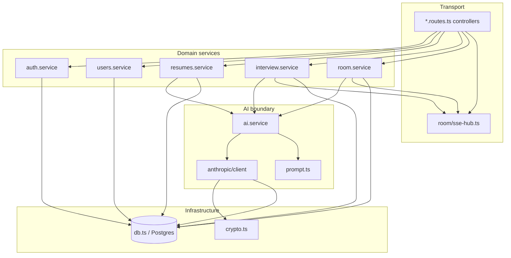
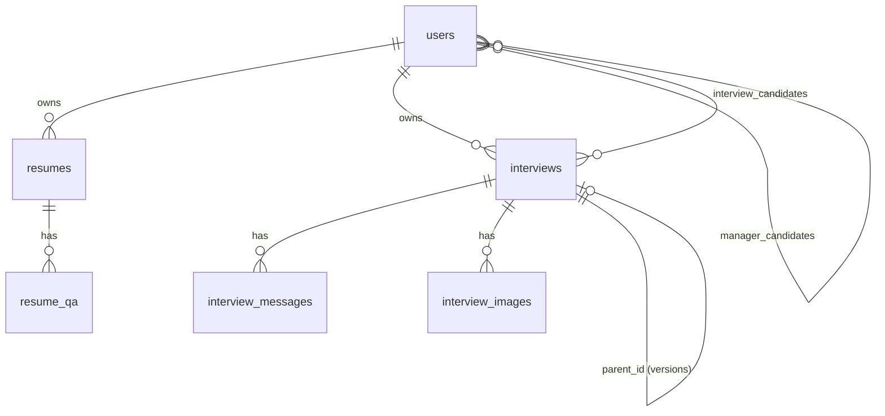
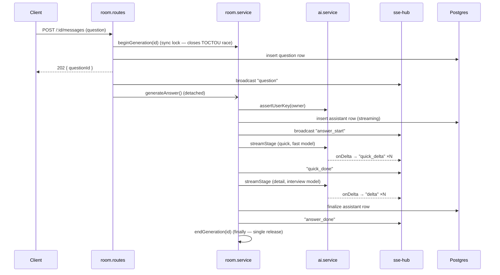

# Backend Architecture

The backend is a **modular monolith** built on **Express 4 + raw `pg` (node-postgres) + zod + JWT**, written in strict TypeScript (ESM). It serves a JSON API under `/api` and a Server-Sent Events (SSE) stream for live interview rooms. Every Anthropic call is billed to the acting user's own encrypted API key — there is no server-wide key.

> Stack: Node.js (ESM), Express 4.21, PostgreSQL via `pg` 8 (no ORM), `@anthropic-ai/sdk`, `jsonwebtoken`, `bcryptjs`, `zod`, `multer`, `helmet`, `express-rate-limit`. Tests: Vitest + Supertest.

## Directory structure

```text
server/src/
├── index.ts                     # entrypoint: build app + listen (PM2 runs dist/index.js)
├── app.ts                       # createApp(): middleware, router mounts, error handler
├── migrate.ts                   # SQL migration runner
├── config/
│   ├── env.ts                   # validated environment (DATABASE_URL, JWT_SECRET, PORT)
│   └── models.ts                # model catalogue, DEFAULT/QUICK/UTILITY models, thresholds
├── infrastructure/
│   ├── db.ts                    # pg Pool, query(), withTransaction()
│   ├── crypto.ts                # AES-256-GCM encrypt/decrypt for stored API keys
│   └── anthropic/client.ts      # per-user Anthropic client factory (cached by key)
├── common/
│   ├── errors.ts                # AppError hierarchy (400/401/402/403/404/409/502)
│   ├── async-handler.ts         # wraps async handlers so rejections reach the error mw
│   ├── error-middleware.ts      # central error → HTTP status/body translation
│   ├── validation.ts            # parse(schema, data) + zodMessage()
│   ├── sql.ts                   # buildUpdate() dynamic SET builder
│   └── types.ts                 # shared domain types (User, InterviewRow, publicUser)
├── modules/
│   ├── auth/        tokens, password, middleware, permissions, schema, service, routes
│   ├── users/       admin user management + candidate directory + assignments
│   ├── resumes/     resume & prepared-Q&A CRUD, PDF/text parse, answer drafting
│   ├── interviews/  CRUD, config, versioning, lifecycle, resume snapshot, prep/summary
│   ├── room/        live room: transcript, SSE gateway, notes, two-stage ask, images
│   └── ai/          Anthropic service (all SDK calls) + interview prompt builder
├── migrations/001_init.sql      # single consolidated schema + admin seed
└── __tests__/{unit,integration}/
```

### Layering & dependency direction

Dependencies point **inward**: routes → services → infrastructure. Transport (HTTP/SSE) and the AI provider are isolated at the edges; business logic never imports Express response objects or the Anthropic SDK directly.



## Module responsibilities

| Module | Owns |
|---|---|
| **auth** | JWT cookie sessions, bcrypt passwords, `requireAuth`/`requireRole`, resource permissions (`canAccessInterview`, `canManageInterview`, `canAccessResume`, `allowedCandidateIds`), account self-service, per-user Anthropic key set/clear/status. |
| **users** | Admin user administration (status/role/password), manager↔candidate assignments, candidate directory (`/api/candidates`). |
| **resumes** | Resume CRUD, prepared-Q&A (Basic Information) CRUD, PDF/text → template parsing and answer drafting (delegated to **ai**). Managers/admins only. |
| **interviews** | Interview CRUD & configuration, candidate assignment, version chains (`parent_id`/`version`), lifecycle (`scheduled`→`interviewing`→`ended`), resume snapshot/recopy/save-back, prep-pack & post-interview summary (delegated to **ai**). |
| **room** | The live interview room: transcript read, SSE event stream, manager notes, two-stage question→answer generation, image upload/serving, save-answer-to-resume. Holds the single-flight generation lock. |
| **ai** | The only place that calls the Anthropic SDK: `streamStage` (streaming), `complete` (one-shot), `matchPreparedQuestion`, `predictFollowUps`, `warmModel`, `assertUserKey`; plus the interview prompt builder. |

### Centralized cross-cutting concerns

- **Errors** — every handler is wrapped with `asyncHandler`; services throw typed `AppError`s; `errorMiddleware` maps them to `{ error, …details }` with the right status, and turns anything unexpected into a logged generic 500 (no internal leakage).
- **Validation** — zod schemas live beside each module; `parse(schema, body)` throws `BadRequestError` with a flattened message, preserving the `{ error }` 400 shape.
- **Permissions** — centralized in `auth.permissions.ts` and applied through access middleware (`requireInterviewRead`/`requireInterviewManage`, `requireResumeAccess`), not re-implemented per handler.
- **Transactions** — `withTransaction(fn)` replaces hand-rolled `BEGIN/COMMIT/ROLLBACK` blocks.
- **Dynamic updates** — `buildUpdate(columnMap, data)` replaces the per-route SET builders and whitelists columns.

## Database

Single consolidated migration (`001_init.sql`). UUID primary keys via `pgcrypto`. No ORM — hand-written parameterized SQL in the service/repository code.



Key points:
- `users` holds role (`admin`/`manager`/`candidate`), approval `status`, and `anthropic_api_key_enc` (AES-256-GCM blob).
- `interviews` carries a config snapshot taken on first start (`resume_text`, `qa_snapshot`, `resume_copied_at`), version chain (`parent_id`, `version`, `carry_summary`), and rolled-up history (`history_summary`, `history_summary_upto`).
- `interview_messages` is the single transcript table, discriminated by `role` (`user`/`assistant`) × `kind` (`question`/`answer`/`note`); notes are never sent to the model.
- Indexes exist on every foreign-key lookup path (owner, parent, candidate joins, transcript-by-time).

## API architecture

All endpoints are mounted under `/api` in `app.ts`; `interviews` and `room` share the `/api/interviews` prefix (disjoint sub-paths). Authentication is a JWT in the `ia_session` httpOnly cookie, verified and re-loaded from the database on every request (so disabled users lose access immediately). Rate limiting guards register/login.

| Prefix | Router | Concern |
|---|---|---|
| `/api/auth` | auth | register, login, logout, me, account, api-key |
| `/api/admin` | users | user administration, manager assignments |
| `/api` | users | `/candidates` directory |
| `/api/resumes` | resumes | resume & Q&A CRUD, parse, draft |
| `/api/interviews` | interviews | CRUD, lifecycle, versioning, prep/summary |
| `/api/interviews` | room | transcript, SSE events, notes, ask/stop, images, save-qa |

The full 45-endpoint contract (methods, paths, status codes, request/response shapes) is unchanged from before the refactor.

## Real-time architecture (SSE)

The live room uses **Server-Sent Events**, not WebSockets. `sse-hub.ts` is pure transport: a per-interview registry of connected `Response`s, fan-out `broadcast`, an in-flight-answer slot for late joiners, and a 25s heartbeat. It knows nothing about interviews, AI, or persistence. Business logic (`room.service.ts`) calls `broadcast(...)`; it never writes to a socket itself.

Clients connect to `GET /api/interviews/:id/events` with cookie auth, receive a `snapshot`, then a stream of 14 named events. On reconnect the client refetches the full transcript, so gaps are closed by refetch rather than SSE replay.



Events (exact names, consumed by `web/src/realtime.ts`): `snapshot, presence, status, question, note, answer_start, quick_delta, quick_done, qa_match, delta, answer_done, answer_error, follow_ups, summary`.

**Single-flight lock.** One generation per interview. The lock (`beginGeneration`) is acquired **synchronously** in the controller before any `await`, so two concurrent asks can't both pass the check (the previous code checked then `await`-ed before setting the lock — a genuine race). It is released in exactly one place per request: `generateAnswer`'s `finally` on the happy path, or the controller on a pre-generation failure.

## AI integration architecture

```text
modules/ai/
├── ai.service.ts   # streamStage, complete, matchPreparedQuestion,
│                   # predictFollowUps, warmModel, assertUserKey, textOf
└── prompt.ts       # systemBlocks (cached), quick/detail/action instructions
infrastructure/anthropic/client.ts  # clientForUser(userId) → key-scoped SDK client
```

- **All** `client.messages.*` calls live in `ai.service.ts`; domain services pass the id of the user whose key pays (interview owner, or acting user for utility calls) plus plain prompt/message data.
- The system prompt is a single cache-controlled block (1h ephemeral TTL) identical across an interview's turns, so it is read from cache after the first request.
- Generation grounds answers strictly in the candidate's resume and prepared answers; the prompt forbids inventing experience. Streaming supports cancellation via `AbortSignal` and surfaces model refusals instead of returning silent empty answers.
- Per-user keys are stored AES-256-GCM encrypted and **never** returned in any response or log (only a `hasKey`/`last4` status).

## Configuration

`config/env.ts` validates `DATABASE_URL` and `JWT_SECRET` (required) and `PORT` (default 9011). There is deliberately no server-wide `ANTHROPIC_API_KEY`. `config/models.ts` centralizes the model catalogue and the `DEFAULT`, `QUICK` (fast line / helpers), and `UTILITY` (resume parse/draft) model ids, plus the history-rollup token threshold.

## Important architectural decisions

1. **Pragmatic modularity over the full reference layout.** ~2,400 LOC does not justify 13 one-file-per-layer modules; related concerns are combined (e.g. assignments live in `users`, prep/summary in `interviews`, messages/sessions/realtime in `room`).
2. **SSE kept, not replaced with WebSockets or Redis.** It already satisfies the one-way streaming need; the in-memory hub and lock keep the server single-instance by design (documented trade-off).
3. **No ORM.** Raw parameterized SQL with thin helpers (`query`, `withTransaction`, `buildUpdate`) keeps the data layer explicit and dependency-light.
4. **Schema untouched.** No migrations were added; the refactor is code-only to protect live records.
5. **Keys billed per user.** Preserves the original billing model; the AI boundary resolves the right user's key for every call.
